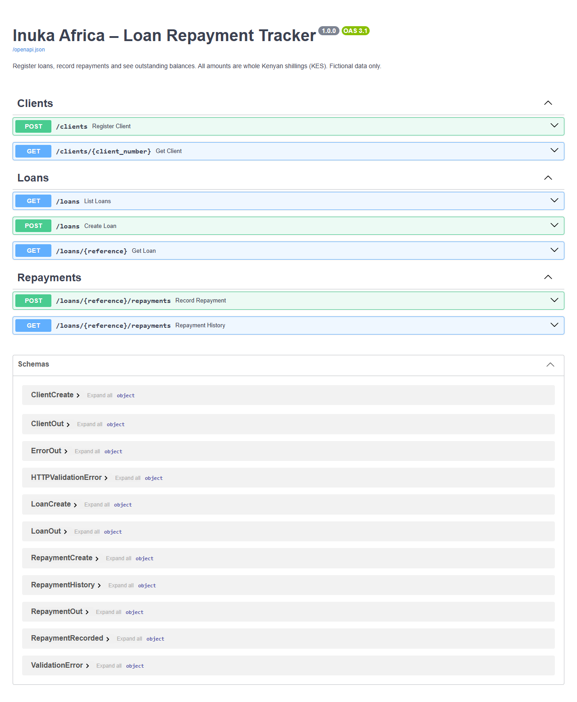
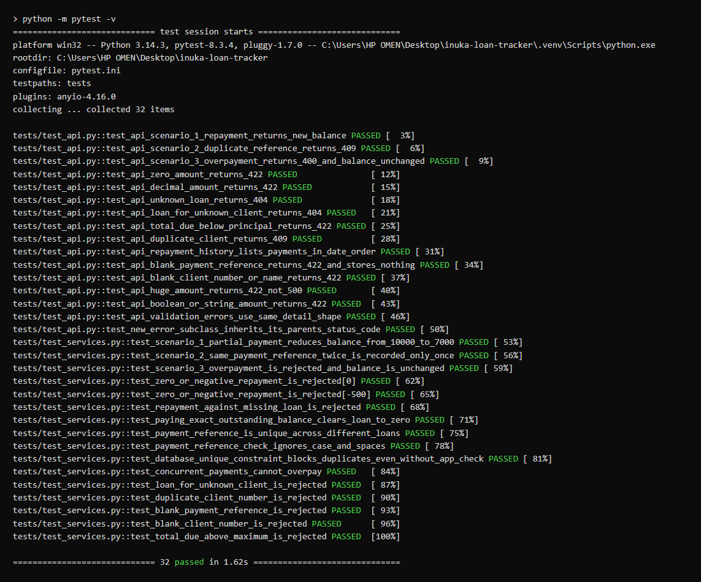
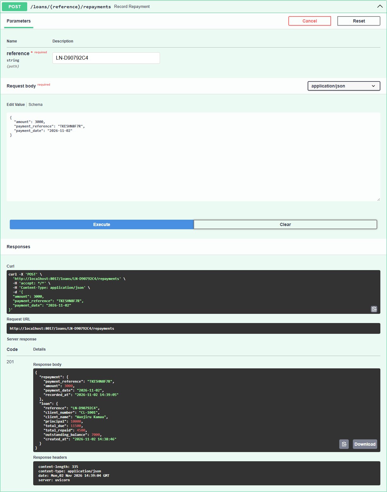
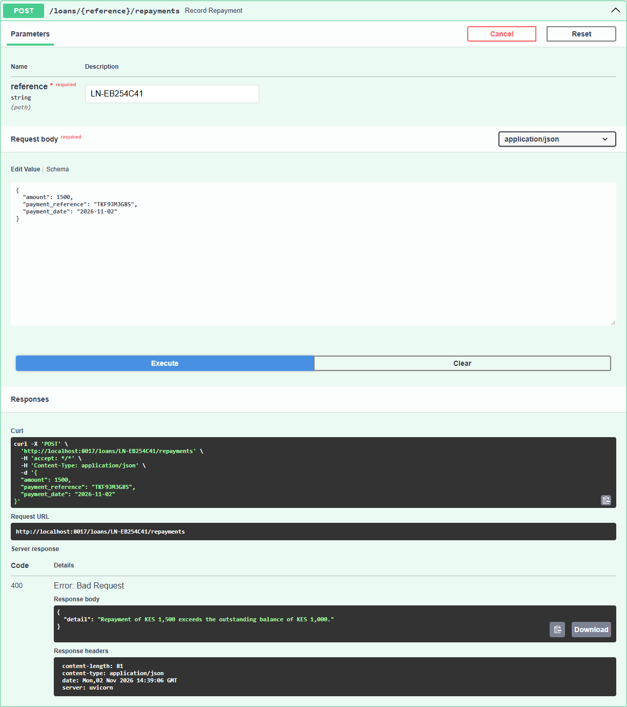
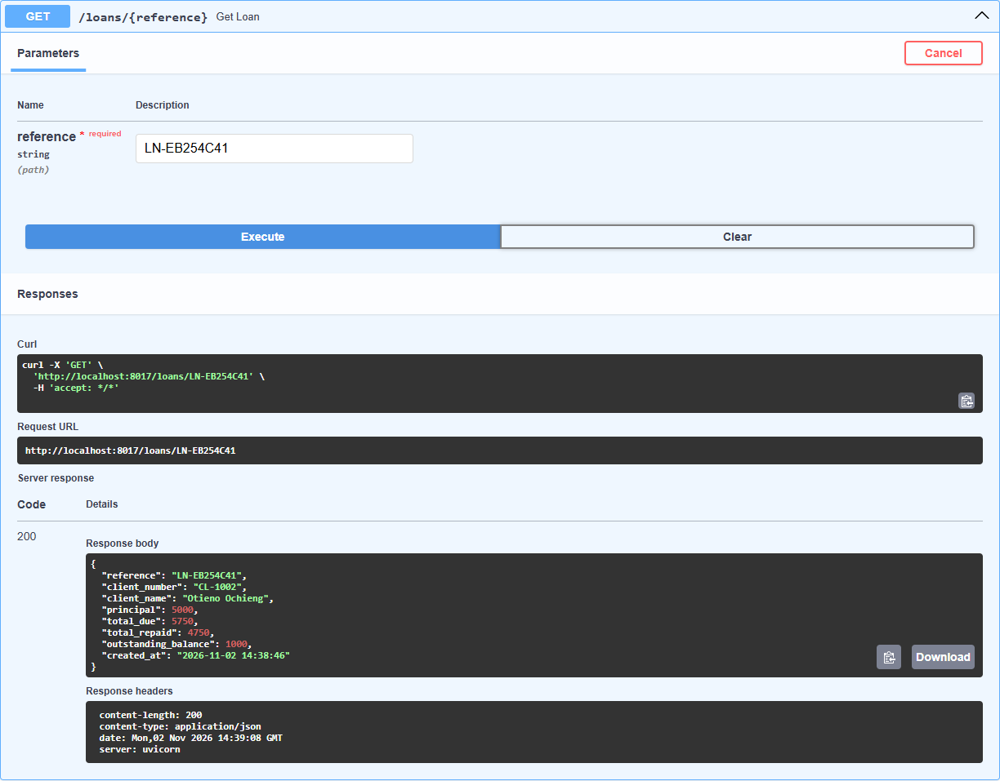
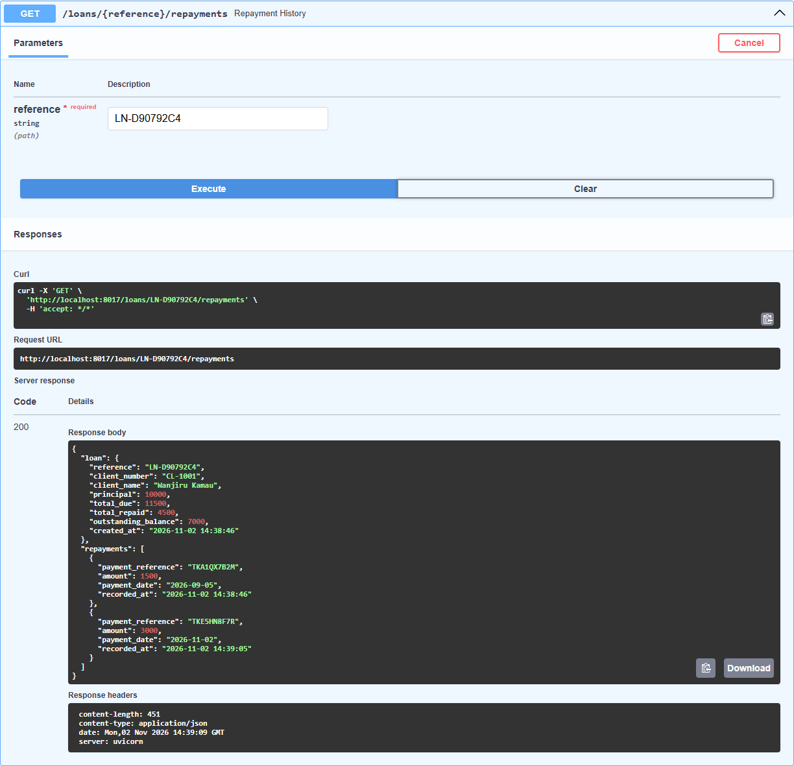
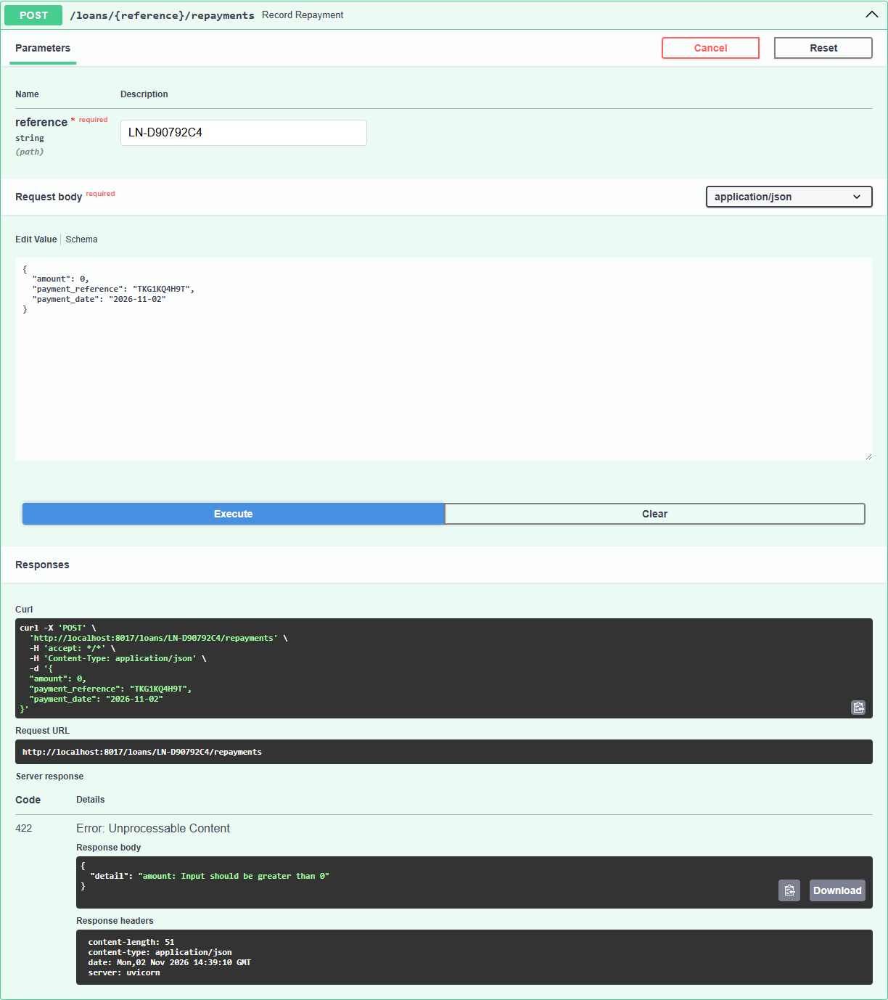
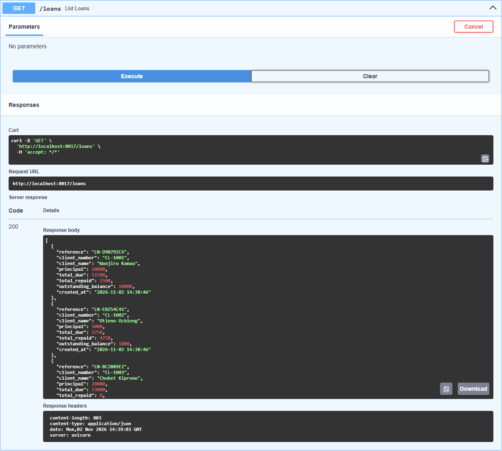

# Inuka Africa – Loan Repayment Tracker

A small API that lets microfinance staff **register clients and loans, record repayments, and see
how much each client still owes**. All amounts are whole Kenyan shillings (KES). All data is fictional.

**Stack:** Python 3.11+ · FastAPI · SQLite (standard `sqlite3` module) · pytest



---

## 1. Run it

```bash
python -m venv .venv
.venv\Scripts\activate          # Windows   (macOS/Linux: source .venv/bin/activate)
pip install -r requirements.txt

python -m scripts.seed          # optional: load fictional demo data into loans.db
uvicorn app.main:app --reload   # start the API
```

Open **http://localhost:8000/docs** to use every endpoint from the browser ("Try it out" → "Execute").

The database file is `loans.db` in the project root (override with the `LOAN_DB_PATH` environment variable).
Tables are created automatically on startup. Delete `loans.db` to start fresh.

## 2. Run the tests

```bash
python -m pytest -v
```

Each test gets a **brand-new SQLite file** in a pytest temp folder, so tests never touch `loans.db`
or each other. 32 tests, about 1.5 seconds.

| Required scenario | Service-level test | API-level test |
|---|---|---|
| 1. 10,000 outstanding, pay 3,000 → 7,000 | `test_scenario_1_partial_payment_reduces_balance_from_10000_to_7000` | `test_api_scenario_1_repayment_returns_new_balance` |
| 2. Same payment reference twice → recorded once | `test_scenario_2_same_payment_reference_twice_is_recorded_only_once` | `test_api_scenario_2_duplicate_reference_returns_409` |
| 3. 1,000 outstanding, pay 1,500 → rejected, balance intact | `test_scenario_3_overpayment_is_rejected_and_balance_is_unchanged` | `test_api_scenario_3_overpayment_returns_400_and_balance_unchanged` |

Further tests cover: zero/negative amounts, decimals, unknown loan, unknown client, paying a loan off
exactly to 0, duplicate references across *different* loans, case/space variants of a reference,
the database constraint on its own, and **two concurrent payments racing for the same balance**.

Run just the three scenarios: `python -m pytest -v -k scenario`



## 3. API

| Method | Path | What it does | Errors |
|---|---|---|---|
| POST | `/clients` | Register a client | 409 client number taken, 422 invalid |
| GET | `/clients/{client_number}` | Get a client | 404 |
| POST | `/loans` | Create a loan for an existing client | 404 unknown client, 422 invalid |
| GET | `/loans` | List all loans with balances | – |
| GET | `/loans/{reference}` | One loan: total due, total repaid, outstanding | 404 |
| POST | `/loans/{reference}/repayments` | Record a repayment | 404, 409, 422, 400 |
| GET | `/loans/{reference}/repayments` | Repayment history + totals | 404 |

Every error body has the same shape: `{"detail": "Readable message"}`. That includes 422
validation errors, e.g. `{"detail": "amount: Input should be greater than 0"}`.

### Example session (curl)

```bash
curl -X POST localhost:8000/clients -H "Content-Type: application/json" \
     -d '{"client_number": "CL-1005", "name": "Akinyi Atieno"}'

curl -X POST localhost:8000/loans -H "Content-Type: application/json" \
     -d '{"client_number": "CL-1005", "principal": 10000, "total_due": 10000}'
# → {"reference": "LN-3F9A1C7E", ..., "outstanding_balance": 10000}

curl -X POST localhost:8000/loans/LN-3F9A1C7E/repayments -H "Content-Type: application/json" \
     -d '{"amount": 3000, "payment_reference": "TKX1Y2Z3A4", "payment_date": "2026-11-02"}'
# → 201, loan.outstanding_balance = 7000

# same request again → 409 {"detail": "Payment reference 'TKX1Y2Z3A4' has already been recorded."}

curl localhost:8000/loans/LN-3F9A1C7E/repayments   # history + totals
```

### Seed data (`python -m scripts.seed`)

| Client | Name | Total due | Paid | Outstanding |
|---|---|---|---|---|
| CL-1001 | Wanjiru Kamau | 11,500 | 1,500 | **10,000** (scenario 1) |
| CL-1002 | Otieno Ochieng | 5,750 | 4,750 | **1,000** (scenario 3) |
| CL-1003 | Chebet Kiprono | 23,000 | 0 | 23,000 |
| CL-1004 | Mutua Musyoka | 3,300 | 3,300 | 0 (fully paid) |

Loan references are random, so the seed script prints them. You can also call `GET /loans`.

### Screenshots

| | |
|---|---|
| Scenario 1: pay 3,000 → balance 7,000 |  |
| Scenario 2: same reference again → 409 |  |
| Scenario 3: pay 1,500 against 1,000 → 400 |  |
| Balance still 1,000 after the rejection |  |
| Repayment history |  |
| Zero amount → 422 |  |
| Unknown loan → 404 |  |
| Seed data |  |

---

## 4. Design

### Project layout

```
app/
  schema.sql   tables, keys and constraints (the data model in one file)
  db.py        connection setup, init_db(), write_transaction()
  schemas.py   Pydantic request/response models: input validation (→ 422)
  errors.py    domain errors: NotFoundError, DuplicateError, BusinessRuleError
  services.py  ALL business logic; no FastAPI imports, so it is tested directly
  routes.py    thin HTTP layer: validate → call service → return
  main.py      FastAPI app + one handler mapping domain errors to 404/409/400
scripts/seed.py  fictional demo data
tests/           conftest.py (isolated DB per test), test_services.py, test_api.py
```

Request flow: **route → Pydantic schema validates shape → service enforces business rules inside a
transaction → database constraints as the last line of defence.**

### Tables

```
clients                          loans                              repayments
─────────────────────            ────────────────────────────       ──────────────────────────────
id            PK                 id          PK                     id                 PK
client_number TEXT UNIQUE NN     reference   TEXT UNIQUE NN         loan_id            FK → loans.id NN
name          TEXT NN            client_id   FK → clients.id NN     amount             INT NN CHECK > 0
created_at                       principal   INT NN CHECK > 0       payment_reference  TEXT UNIQUE NN
                                 total_due   INT NN                 payment_date       TEXT (ISO date) NN
                                             CHECK >= principal     created_at
                                 created_at
```

- **One client has many loans; one loan has many repayments.** Foreign keys are switched on with
  `PRAGMA foreign_keys = ON` (SQLite leaves them off by default).
- `client_number`, `loans.reference` and `payment_reference` are all `UNIQUE`.
- `idx_repayments_loan_id` speeds up summing a loan's repayments.

### Money is stored as integers

Amounts are `INTEGER` whole shillings. Floating point can't represent many decimals exactly
(`0.1 + 0.2 == 0.30000000000000004`), and rounding errors in a ledger are unacceptable. Whole
shillings match how M-Pesa and cash repayments work in Kenya. *Trade-off:* no cents. Supporting
them would mean storing cents (×100) and formatting on output.

Money fields are **strict integers**, so `100.5`, `"3000"` and `true` are all rejected with a 422.
They are capped at **KES 100,000,000** (`MAX_AMOUNT_KES`). That's far above any microloan, and it keeps
values well inside SQLite's 64-bit `INTEGER`, which would otherwise overflow into a 500 error.

### How the outstanding balance is calculated

```
outstanding_balance = loans.total_due − SUM(repayments.amount for that loan)
```

This is `get_outstanding_balance()` in [`app/services.py`](app/services.py), which uses
`get_total_repaid()` (`SELECT COALESCE(SUM(amount), 0) ...`; `COALESCE` turns "no repayments" into 0).

There is **no stored balance column**. If there were, every repayment would have to update two
places, and any bug or partial failure could leave them disagreeing. Because the balance is derived
from the repayment rows every time, it is correct by construction. *Trade-off:* one `SUM` query per read,
which is negligible at this scale and helped by the `loan_id` index.

`principal` is stored for reporting. The client owes `total_due` (principal plus interest/fees,
supplied by staff, so this app doesn't need to know the institution's interest rules).

### How each business rule is enforced

| Rule | Pydantic (`schemas.py`) | Service (`services.py`) | Database (`schema.sql`) | HTTP |
|---|---|---|---|---|
| Amount > 0, whole KES, ≤ 100M | `Kes = Field(strict=True, gt=0, le=...)` | `if amount <= 0` | `CHECK (amount > 0)` | 422 |
| Payment reference, client number and name not blank | `StringConstraints(strip_whitespace=True, min_length=1)` | `if not payment_reference` | `CHECK (... <> '')` | 422 |
| No overpayment | – | `if amount > outstanding`, inside a locked transaction | – | 400 |
| Payment reference used once, globally | – | `SELECT 1 ... WHERE payment_reference = ?` | `UNIQUE (payment_reference)` | 409 |
| Loan must exist | – | `_get_loan_row()` raises `NotFoundError` | `FOREIGN KEY loan_id` | 404 |
| Balance always correct | – | derived, never stored | – | – |
| Client number unique | – | catches `IntegrityError` | `UNIQUE (client_number)` | 409 |
| Loan needs a real client | – | `get_client()` raises `NotFoundError` | `FOREIGN KEY client_id` | 404 |
| `total_due >= principal` | `model_validator` | `if total_due < principal` | `CHECK` | 422 |

### Duplicate payments: two layers

1. **Application check:** before inserting, `record_repayment()` looks the reference up and raises
   `DuplicateError` with a clear message. It runs *before* the overpayment check, so re-sending a
   payment that already cleared a loan is reported as "duplicate", not as a confusing "overpayment".
2. **Database guarantee:** `payment_reference` is `UNIQUE`. If anything ever slipped past layer 1
   (a bug, a different client app, a raw SQL insert), SQLite refuses the row. The service converts
   that `sqlite3.IntegrityError` into the same `DuplicateError` → 409.

References are normalised (`strip().upper()`) so `tka1qx7b2m` and `TKA1QX7B2M ` count as the same
payment, matching how M-Pesa codes look.

### Transactions and concurrency

`record_repayment()` runs "find loan → check duplicate → compute balance → compare → insert" inside
`write_transaction()` ([`app/db.py`](app/db.py)), which issues **`BEGIN IMMEDIATE`**. That takes
SQLite's write lock *before* reading the balance. A second cashier submitting at the same moment
waits, then sees the updated balance. Two 600-shilling payments against a 1,000 balance can never
both succeed (`test_concurrent_payments_cannot_overpay`). Any exception triggers `ROLLBACK`, so
a rejected payment leaves nothing behind. The response, including the new balance, is also built
*before* `COMMIT`, so it shows exactly the balance this payment produced.

### Error handling

Services raise plain domain errors (`errors.py`). Each error class carries its own `status_code`:
`NotFoundError → 404`, `DuplicateError → 409`, `BusinessRuleError → 400`. `main.py` has one
handler that returns `exc.status_code`. A new subclass such as `OverpaymentError(BusinessRuleError)`
inherits its status automatically and never falls through to a 500. Malformed input (wrong types,
`amount <= 0`, blank text, missing fields, bad dates) is rejected by Pydantic with **422** before any
business code runs. A second handler flattens Pydantic's error list into the same `{"detail": "..."}` shape.
The overpayment is **400** rather than 422 because the request is well formed but breaks a rule
given the loan's current state.

### Loan references

`LN-` + 8 random hex characters from a UUID (e.g. `LN-3F9A1C7E`). Being random, there is no race
for "the next number", and the `UNIQUE` constraint guards against the vanishingly small chance of a
collision. *Trade-off:* less friendly than a sequential `LN-0001`.

### Deliberately out of scope

Authentication, interest calculation, loan statuses, editing or reversing repayments, pagination,
and real payment integrations. All are reasonable next steps but beyond the brief.

---

## 5. AI usage disclosure

I used **Claude Code (Anthropic)** as a pair-programming assistant throughout this assessment.

- **Design:** I set the stack and the constraints (integer money, a derived balance, a database-level
  UNIQUE on payment references, one transaction for check-then-insert, a separate service layer).
  Claude proposed the schema and folder layout for me to approve.
- **Code and tests:** Claude wrote the code (models, services, routes, error handling) and the pytest
  suite, including the three required scenarios and a concurrency test.
- **Review and fixes:** I asked Claude to review the API against this brief. It found and confirmed six
  defects, e.g. blank payment references were accepted and very large amounts caused a 500 error.
  Claude fixed them and added regression tests.
- **Docs and tooling:** Claude wrote this README, the fictional seed data, and a script that captured
  the screenshots in `docs/screenshots/` from the running API. It also set up the Git repository.

I reviewed the code, ran the application and the tests myself, and can explain how the outstanding
balance is calculated, how each business rule is enforced, and the trade-offs above.
